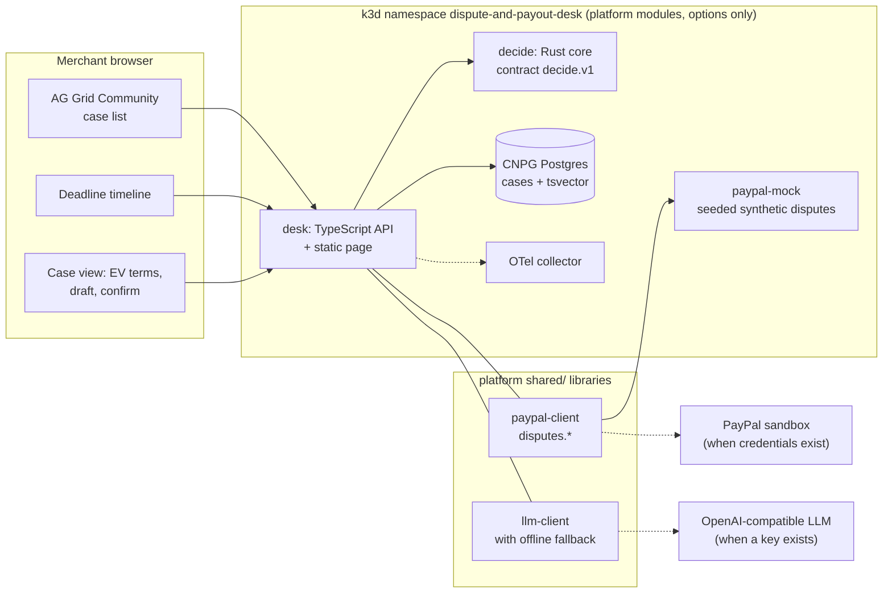
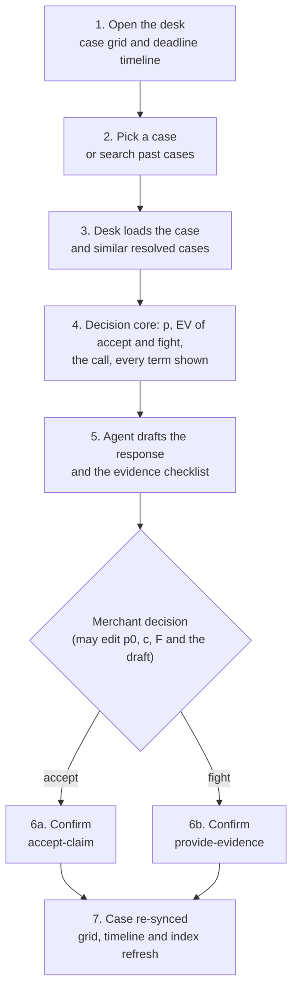

# Dispute and Payout Desk

A seller's desk for PayPal disputes, built for the [PayPal AI Hackathon 2026](https://developer.paypal.com/community/blog/PayPal_AI_Hackathon/)
("Build What's Next with PayPal and AI"). It reads a merchant's disputes through PayPal's Disputes v1 API, finds
similar resolved cases, computes whether to **fight or accept** each one as an expected-value decision with every term
shown, drafts the seller response with an evidence checklist, and writes the merchant's choice back to PayPal after an
explicit confirmation.

- Proposal: `projects/dispute-and-payout-desk/proposal.md` in the platform repo's docs vault
  ([Ikigai-Dynamics/paypal-hackathon-2026](https://github.com/Ikigai-Dynamics/paypal-hackathon-2026)).
- Platform: the shared flake, Nix modules, PayPal mock, clients and k3d cluster scripts all come from the platform repo.
  This repo only sets `platform.*` options in `nix/project.nix` and holds the application code.

PayPal use: Disputes v1 read (list, get) and write (`provide-evidence`, `accept-claim`) through the shared
`@jeirslab/paypal-client`. AI use: the response drafter (`@jeirslab/llm-client`, OpenAI-compatible) with a deterministic
offline fallback. The money decision is arithmetic in a Rust core, not a model.

## Run from a clone

Needs Nix with flakes, Docker (for k3d) and SSH access to GitHub (the platform input is a private repo). k3d, kubectl and
helm come from nixpkgs through the flake; nothing is installed system-wide and `~/.kube/config` is never touched.

```sh
git clone git@github.com:Ikigai-Dynamics/paypal-2026-dispute-and-payout-desk.git && cd paypal-2026-dispute-and-payout-desk
nix run .#cluster-up       # k3d: 1 server + 3 agents, Traefik on host port 18080
nix run .#deploy           # builds the images, installs CNPG, applies manifests, waits for rollouts
nix run .#e2e              # scripted fight + accept; prints the decision terms and the draft; ends with E2E OK
```

Then open <http://desk.dispute-and-payout-desk.localhost:18080> (`*.localhost` resolves to 127.0.0.1 in most browsers;
otherwise use `curl --resolve desk.dispute-and-payout-desk.localhost:18080:127.0.0.1 ...`). The mock is at
`paypal-mock.dispute-and-payout-desk.localhost:18080`.

Developing against an uncommitted platform checkout:

```sh
nix flake check --override-input platform path:/path/to/paypal-hackathon-2026
nix run .#deploy --override-input platform path:/path/to/paypal-hackathon-2026
nix run .#e2e --override-input platform path:/path/to/paypal-hackathon-2026
```

Tear down: `nix run .#undeploy -- dispute-and-payout-desk` (this project only) or `nix run .#cluster-down`.

## Architecture

The `desk` (TypeScript, Node 24) syncs every dispute from PayPal into Postgres (CloudNativePG) as an index with a
`tsvector` column; PayPal stays the source of truth. For a case it loads resolved cases of the same reason ranked by
full-text similarity (the precedents), calls the Rust `decide` core over the versioned contract `decide.v1`
(`contracts/decide.v1.md`), asks the LLM client for the draft, and serves a plain page with an AG Grid Community case
grid, a deadline timeline and a case panel. Writes go to PayPal only behind `confirm: true`, then the case is re-read.
Everything runs in k3d; the PayPal mock stands in for PayPal and the OpenTelemetry collector receives traces.





## The decision: expected value

With `A` the disputed amount, `F` the extra fee if the seller loses (default $0), `c` the handling cost of fighting
(default $15.00) and `p` the probability of winning:

- `p = (wins + k*p0) / (n + k)` with `k = 4`: the win rate of `n` similar resolved cases, pulled toward a prior `p0`.
- `EV accept = -A`
- `EV fight = -(1-p)*(A+F) - c`
- fight when `EV fight > EV accept`, that is when `p*A - (1-p)*F - c > 0`. A margin under $5 is labelled marginal.

The priors `p0` per reason are **an assumption, not PayPal data** (`decide/src/priors.rs`): not received 0.45 (0.60 with
evidence), not as described 0.35 (0.45 with evidence), unauthorised 0.25, duplicate and credit not processed 0.30,
cancelled recurring billing 0.40, anything else 0.35. The page lets the merchant override p0, c and F. All arithmetic is
integer cents, rounded half away from zero.

Worked example, $120 item-not-received with p0 0.55 and no precedents: `EV accept = -$120.00`,
`EV fight = -(0.45)*120.00 - 15.00 = -$69.00`, so fight beats accept by `0.55*120 - 15 = +$51.00`. A $9 case at p0 0.35:
`0.35*9 - 15 = -$11.85`, so accept. Lower c to $2 and `3.15 - 2 = +$1.15` flips it to fight (marginal).

## Search

Search is **Postgres full-text** (`tsvector`, `websearch_to_tsquery`, `ts_rank`, `ts_headline`) over the reason, buyer and
seller messages, item descriptions and evidence notes. **Elastic is not used.** The same index ranks the precedents.

## Synthetic data and guardrails

- All disputes come from the shared PayPal mock (`MOCK_SEED=7`, 60 disputes, `MOCK_NOW=now` so deadlines are in the
  future). They are synthetic. Mock fidelity is marked unverified in places (error codes on writes, state transitions).
- The page shows a "Synthetic disputes from the PayPal mock" banner whenever `PAYPAL_ENV` is `mock`.
- Writes (`Submit evidence`, `Accept claim`) need a confirmation dialog in the page and `confirm: true` in the API.
- The drafter is told to cite only evidence present in the case; the offline fallback never writes a tracking number the
  case does not hold; the explanation restates the decision terms and does not invent numbers.
- The page labels the draft source ("AI: llm <model>" or "AI: offline fallback").

## Demo script (2-3 minutes)

Before recording, run `nix run .#demo-reset`. It resets the mock, recreates `PP-D-E2E-FIGHT` and `PP-D-E2E-ACCEPT` and
syncs the desk, so both are open. `nix run .#e2e` submits and accepts them, so run `demo-reset` again after it.

| Time | Do | Say |
| --- | --- | --- |
| 0:00-0:20 | Open the page and read the situation line. | A dispute is a deadline, an amount and no clear answer. |
| 0:20-0:50 | Click Start with the most urgent case. | It lands on `PP-D-E2E-FIGHT` ($120, not received, due in 2 days). |
| 0:50-1:20 | Read the recommendation, then Show the math. | We recommend fighting, with the win chance from similar past cases; the math is behind the disclosure. The draft cites the UPS tracking number on the case. |
| 1:20-1:50 | Add the missing delivery confirmation, then Submit response to PayPal and confirm. | The checklist had one gap; once filled the response goes to PayPal and the PayPal API strip shows the call. |
| 1:50-2:10 | Open `PP-D-E2E-ACCEPT` ($9 digital download). | For $9 the call is accept. Set Cost to fight from $15 to $2: the call flips to a close-call fight. |
| 2:10-2:40 | Show `nix run .#cluster-up`, `deploy`, `e2e` and this README. | Runs from a clone with Nix; k3d with CNPG Postgres; data is synthetic and writes need confirmation. |

## Secrets

None is required under the mock. At deploy time each name below is read from the caller's environment into the Kubernetes
Secret `platform-env` (`injectEnv`: only names that are set; the deploy prints the names, never the values). Nothing is
written to a file in this repository. Because `platform.paypalMock.injectEnv` is on, the mock wins over real PayPal
credentials in the Secret; set it to `false` in `nix/project.nix` to use the sandbox.

| Name                    | Required | What it enables                                                                  |
| ----------------------- | -------- | -------------------------------------------------------------------------------- |
| `PAYPAL_CLIENT_ID`      | no       | PayPal sandbox app client id. Set with `PAYPAL_CLIENT_SECRET` to leave the mock. |
| `PAYPAL_CLIENT_SECRET`  | no       | PayPal sandbox app secret.                                                       |
| `PAYPAL_ENV`            | no       | `mock`, `sandbox` or `live` (`live` also needs `PAYPAL_ALLOW_LIVE=1`).           |
| `PAYPAL_BASE_URL`       | no       | Override the PayPal base URL.                                                    |
| `LLM_BASE_URL`          | no       | OpenAI-compatible endpoint for the response drafter.                             |
| `LLM_API_KEY`           | no       | API key for that endpoint.                                                       |
| `LLM_MODEL`             | no       | Model name; with the two above turns the LLM on (otherwise the offline fallback). |
| `ELASTIC_OTLP_ENDPOINT` | no       | Elastic managed OTLP endpoint (needs `platform.otel.elastic.enable`; not enabled).|
| `ELASTIC_API_KEY`       | no       | Elastic API key for the exporter.                                                |

## Layout

| Path | What |
| --- | --- |
| `nix/project.nix` | Options only, plus the `e2e` script package. |
| `desk/` | TypeScript API and static page (`src/`, `public/`, `test/`). |
| `decide/` | Rust core for contract `decide.v1`. |
| `contracts/` | Contract prose and the canonical golden cases; `decide/fixtures/` and `desk/test/fixtures/` hold copies, enforced identical by a flake check. |
| `scripts/e2e.sh` | The end-to-end script. |

## Known gaps

- Bryntum is not evaluated: the timeline is a plain HTML/CSS strip.
- The sandbox path (real PayPal credentials) has not been run; there are no credentials yet.
- No webhooks: the desk syncs on start and on `POST /api/sync` (button on the page).
- Mock fidelity is unverified for write error codes and state transitions.
- Evidence is text only (no file uploads); no auth on the desk; the priors are assumptions.
- Not covered by tests: the Postgres queries (SQL) run only in the cluster e2e.

## Licence

Apache-2.0, see `LICENSE`.
