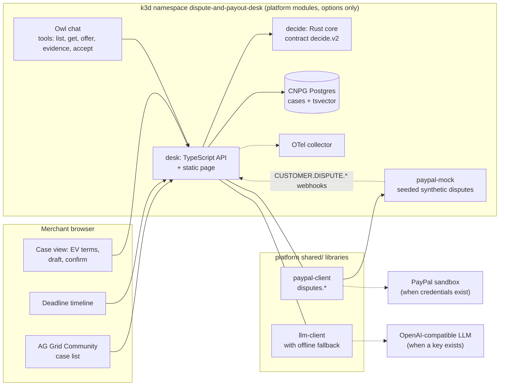
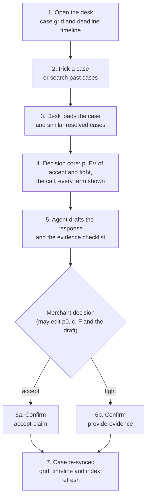

# Parley: a dispute desk for PayPal sellers

Parley reads your PayPal disputes and tells you, case by case, whether to fight, refund or offer $X, with an estimated chance of winning.
It drafts the reply and the evidence list for you, and sends nothing to PayPal without your OK.

PayPal APIs used: Disputes v1 (list, get, provide-evidence, accept-claim, make-offer), Webhooks (`CUSTOMER.DISPUTE.CREATED`, `UPDATED`, `RESOLVED`, checked with verify-webhook-signature) and Transaction Search (the buyer's order history). Built for the [PayPal AI Hackathon 2026](https://developer.paypal.com/community/blog/PayPal_AI_Hackathon/).

## Try it in 60 seconds

**With Docker (no Nix).** The shared packages (PayPal client, LLM client, PayPal mock) live in the platform repo, so a checkout of [paypal-hackathon-2026](https://github.com/Ikigai-Dynamics/paypal-hackathon-2026) must sit next to this repo (or set `PLATFORM_DIR` to it).

```sh
docker compose up --build
```

Then open <http://localhost:8080>. It starts Postgres, the PayPal mock, the decision core and the desk. Optional: set `LLM_BASE_URL`, `LLM_MODEL` and `LLM_API_KEY` in your shell first to turn the AI on; without them Parley uses template drafts and says so.

**Walkthrough (about a minute):**

1. Open the top case in the list.
2. Read Parley's call (fight, refund or offer) and the win chance next to it.
3. Attach the evidence the checklist asks for.
4. Click **Review my reply**, then **Send reply to PayPal** and confirm.
5. Click the owl and ask: *Which cases should I just refund?*

### Run on the dev cluster

Needs Nix with flakes, Docker (for k3d) and SSH access to GitHub (the platform input is a private repo). k3d, kubectl and
helm come from nixpkgs through the flake; nothing is installed system-wide and `~/.kube/config` is never touched.

```sh
git clone git@github.com:Ikigai-Dynamics/paypal-2026-dispute-and-payout-desk.git && cd paypal-2026-dispute-and-payout-desk
nix run .#cluster-up       # k3d: 1 server + 3 agents, Traefik on host port 18080
nix run .#deploy           # builds the images, installs CNPG, applies manifests, waits for rollouts
nix run .#e2e              # scripted fight on one case and accept on another; ends with E2E OK
```

Then open <http://desk.dispute-and-payout-desk.localhost:18080> (`*.localhost` resolves to 127.0.0.1 in most browsers;
otherwise use `curl --resolve desk.dispute-and-payout-desk.localhost:18080:127.0.0.1 ...`). The mock is at
`paypal-mock.dispute-and-payout-desk.localhost:18080`. A deploy reseeds the demo; `nix run .#demo-reset` resets between takes.

Against an uncommitted platform checkout add `--override-input platform path:/path/to/paypal-hackathon-2026` to `nix flake check`, `nix run .#deploy` and `nix run .#e2e`.
Tear down: `nix run .#undeploy -- dispute-and-payout-desk` or `nix run .#cluster-down`.

## What is real and what is simulated

- **PayPal is the bundled PayPal mock**, which implements the Disputes v1 shapes (and Transaction Search, webhooks). Runs against the bundled PayPal mock; a live sandbox run was not done for this submission (no sandbox credentials in the build environment). The client and the desk have a sandbox path (`PAYPAL_ENV=sandbox` with a client id and secret) that has not been exercised.
- **The AI is a real LLM** reached through an OpenAI-compatible endpoint (`@jeirslab/llm-client`). It drafts replies and answers in the chat. Without a key the desk falls back to template drafts and labels them as such.
- **The money decision is integer-cent arithmetic in the Rust core**, not a model.
- **Win chances are estimated**: a beta posterior from similar past cases, pulled toward an assumed starting guess. They are not calibrated against PayPal outcomes.

## Chat tools

The owl chat can call tools named after PayPal's Agent Toolkit where one exists:

- From the Agent Toolkit: `list_disputes`, `get_dispute`, `accept_dispute_claim`.
- Added by Parley in the same style: `make_dispute_offer`, `provide_dispute_evidence`.

Every tool that writes to PayPal shows what it will send and waits for your confirmation (`confirm: true` in the API).

## How Parley decides

For each case the desk finds resolved cases of the same reason (full-text similarity) and calls the Rust `decide` core over the versioned contract `decide.v2` ([`contracts/decide.v2.md`](contracts/decide.v2.md)). It compares three outcomes in expected value, in plain words:

- **Refund** (accept the claim) costs the whole amount.
- **Fight** costs the handling effort (and the AI cost of the draft) plus, if you lose, the amount; it pays off when the win chance is high enough.
- **Offer $X** (a partial refund) is the best amount found on a 50-cent scan, assuming buyers accept bigger offers more often. It is the call only when it beats both others by at least $5.

With `A` the amount, `F` the extra fee if the seller loses, `c` the handling cost plus AI cost, and `p` the win chance:

- `p = (wins + K*p0) / (n + K)`, `K = 4`: the win rate of `n` similar cases pulled toward a prior `p0` per reason. A repeat disputer moves `p0` up by 10 points.
- `EV accept = -A`, `EV fight = -(1-p)*(A+F) - c`; fight when `EV fight > EV accept`. Under $5 of difference is labelled marginal.
- `EV offer(x) = q(x)*(-x) + (1-q(x))*EV fight` with `q(x) = 1/(1+exp(-s*(x/A - m)))`, `m = 0.5`, `s = 8`.

Every default (priors, K, acceptance curve, minimum gain, handling cost) is an assumption, not PayPal data, and is served at `GET /api/assumptions`. All arithmetic is integer cents, rounded half away from zero. Worked example: a $120 item-not-received case at `p0 = 0.55` with no precedents: `EV accept = -$120.00`, `EV fight = -0.45*120.00 - 15.00 = -$69.00`, so fighting gains `$51.00`.

## Data, assumptions and limits

- All disputes are synthetic: the mock serves a seeded demo merchant (60 disputes), with dates shifted so deadlines are in the future. No real merchant data is used. The page says so whenever `PAYPAL_ENV` is `mock`.
- One desk replica; drafts and decisions are cached in memory per pod, and every desk start reseeds the demo.
- Evidence is text and tracking details only: no file upload. No sign-in on the desk.
- Win chances and the priors are assumptions. Mock fidelity is unverified for write error codes and state transitions.
- Search is Postgres full-text (`tsvector`); Elastic is not used.
- Webhooks are accepted at the desk; signature verification runs only against a sandbox or live target, and is skipped under the mock.
- The Postgres queries are covered only by the cluster e2e, not by unit tests.

## Architecture

The `desk` (TypeScript, Node 24) syncs every dispute from PayPal into Postgres (CloudNativePG; plain Postgres under Compose) as an index with a
`tsvector` column; PayPal stays the source of truth. For a case it loads resolved cases of the same reason ranked by
full-text similarity (the precedents), calls the Rust `decide` core over the versioned contract `decide.v2`
(`contracts/decide.v2.md`), asks the LLM client for the draft, and serves a page (React 18 + TypeScript, built by Vite inside the Nix build and served from the same paths, with AG Grid React for All cases) with a case
grid, a deadline timeline and a case panel. The desk also accepts PayPal dispute webhooks to refresh a case. Writes go to PayPal only behind `confirm: true`, then the case is re-read.
Everything runs in k3d (or in Docker Compose); the PayPal mock stands in for PayPal and the OpenTelemetry collector receives traces.





## Environment and secrets

None is required under the mock. At deploy time each name below is read from the caller's environment into the Kubernetes
Secret `platform-env` (`injectEnv`: only names that are set; the deploy prints the names, never the values). Nothing is
written to a file in this repository. Because `platform.paypalMock.injectEnv` is on, the mock wins over real PayPal
credentials in the Secret; set it to `false` in `nix/project.nix` to use the sandbox. The compose file sets the same names for the desk (`DATABASE_URL`, `DECIDE_URL`, `PAYPAL_*`, optional `LLM_*`).

| Name                    | Required | What it enables                                                                  |
| ----------------------- | -------- | -------------------------------------------------------------------------------- |
| `PAYPAL_CLIENT_ID`      | no       | PayPal sandbox app client id. Set with `PAYPAL_CLIENT_SECRET` to leave the mock. |
| `PAYPAL_CLIENT_SECRET`  | no       | PayPal sandbox app secret.                                                       |
| `PAYPAL_ENV`            | no       | `mock`, `sandbox` or `live` (`live` also needs `PAYPAL_ALLOW_LIVE=1`).           |
| `PAYPAL_BASE_URL`       | no       | Override the PayPal base URL.                                                    |
| `PAYPAL_SANDBOX_CLIENT_ID`     | no | Sandbox app for the payout step only (platform secretEnv; unused here). |
| `PAYPAL_SANDBOX_CLIENT_SECRET` | no | Its secret. |
| `LLM_BASE_URL`          | no       | OpenAI-compatible endpoint for the response drafter.                             |
| `LLM_API_KEY`           | no       | API key for that endpoint.                                                       |
| `LLM_MODEL`             | no       | Model name; with the two above turns the LLM on (otherwise the offline fallback). |
| `ELASTIC_OTLP_ENDPOINT` | no       | Elastic managed OTLP endpoint (needs `platform.otel.elastic.enable`; not enabled).|
| `ELASTIC_API_KEY`       | no       | Elastic API key for the exporter.                                                |

## Layout

| Path | What |
| --- | --- |
| `nix/project.nix` | Options only, plus the `e2e` script package. |
| `desk/` | TypeScript API (`src/`), Vite + React page (`web/`), tests (`test/`, `web/**/*.test.tsx`). |
| `decide/` | Rust core for contract `decide.v2`. |
| `contracts/` | Contract prose and the canonical golden cases; `decide/fixtures/` and `desk/test/fixtures/` hold copies, enforced identical by a flake check. |
| `docker-compose.yml`, `desk/Dockerfile`, `decide/Dockerfile`, `mock/Dockerfile` | Run without Nix. |
| `render.yaml` | Render Blueprint (free tier); not deployed from here. Needs the platform `shared/` vendored as `./platform/shared`. |
| `scripts/e2e.sh` | The end-to-end script. |

## Licence

MIT, see `LICENSE`. Copyright 2026 Ikigai Dynamics.
